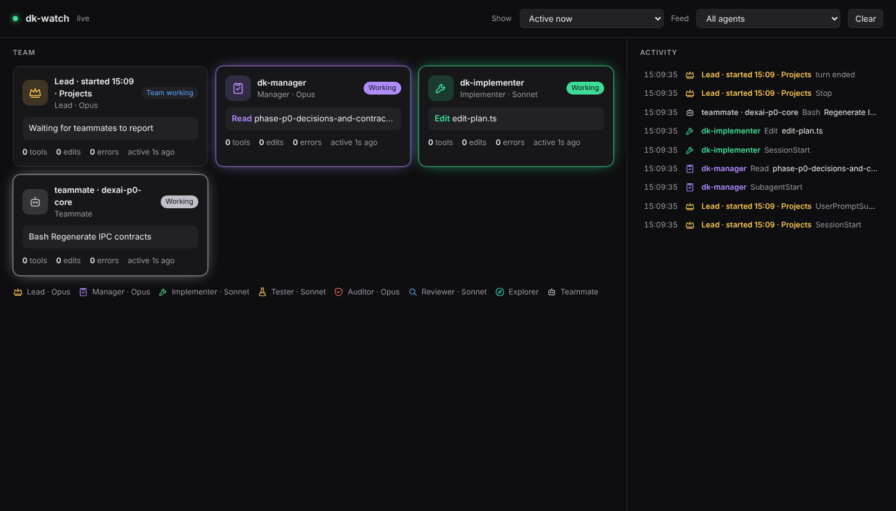

# dk-team

**A Claude Code agent team that runs a goal loop until the work is actually done, with a live browser dashboard so you can watch every agent.**

You give the lead a goal. A **manager** turns it into testable acceptance criteria and tasks, **implementers** build in parallel, a **tester** proves each criterion, a **reviewer** and an **auditor** check conventions and risk, and the manager judges **ACCEPT / REWORK / ESCALATE**. It loops (max 3 rounds) until the criteria are met. Everything stays **local**: nothing is pushed or opened as a PR until you say so.



macOS and Linux.

---

## Contents

- [The team](#the-team)
- [Requirements](#requirements)
- [Install](#install)
- [First run](#first-run)
- [Using it](#using-it)
- [The dashboard (dk-watch)](#the-dashboard-dk-watch)
- [Hooks](#hooks)
- [Local-only mode](#local-only-mode)
- [Profiles](#profiles)
- [Commands](#commands)
- [What gets installed where](#what-gets-installed-where)
- [Customising](#customising)
- [Troubleshooting](#troubleshooting)
- [Uninstall](#uninstall)

---

## The team

Roles are Claude Code **agents** (`agents/*.md`), each pinned to a model in its frontmatter. The role decides what an agent may do; the model is chosen for the job.

| Role | Agent | Model | Edits code? | Job |
|---|---|---|---|---|
| Lead | your main Claude Code session | your session's model | only to integrate | talks to you, writes the goal, runs the loop, commits locally after ACCEPT |
| Manager | `dk-manager` | Opus | no | makes criteria testable, cuts tasks and seams; judges each round |
| Implementer | `dk-implementer` | Sonnet | yes, its task only | builds one task, runs the gates, reports evidence |
| Tester | `dk-tester` | Sonnet | tests only | maps every criterion to a check, adds missing tests, runs suites |
| Reviewer | `dk-reviewer` | Sonnet | no | dk-coding conventions + repo gates |
| Auditor | `dk-auditor` | Opus | no | security, privacy, licences, cost, production safety |

The loop, in the `dk-agents` skill:

```
goal ─► manager plans ─► implementers build ─► tester proves ─► reviewer + auditor check
   ▲                                                                          │
   └──────────── REWORK (numbered fix list, max 3 rounds) ◄── manager verdict ┘
                                                    ACCEPT ─► lead commits locally ─► you decide when to ship
```

Also included: the **dk-coding** conventions (hexagonal architecture, strict DRY, versioned units, typed errors, tests) as skills and rule files, plus `/dk-review`, `/dk-dry`, `/dk-new-unit` and `/dk-bump`.

## Requirements

| Need | Why | Get it |
|---|---|---|
| [Claude Code](https://code.claude.com/docs) | runs the agents | `curl -fsSL https://claude.ai/install.sh \| bash` |
| Node.js ≥ 20 | hooks, dashboard, installer | [nodejs.org](https://nodejs.org) or `brew install node` |
| git | worktrees for parallel implementers | preinstalled on macOS (Xcode CLT) / your package manager |
| tmux (optional) | split panes for teammates | `brew install tmux` / `apt install tmux` |

## Install

**Private repo (or any clone):**

```bash
git clone https://github.com/denmarkamanodaya/dk-team.git ~/.dk-team
~/.dk-team/install.sh
```

**Public repo, one line:**

```bash
curl -fsSL https://raw.githubusercontent.com/denmarkamanodaya/dk-team/main/install.sh | bash
```

The installer shows what it will do and asks once. Options (pass them to `install.sh` or `dk-team install`):

| Option | Default | Meaning |
|---|---|---|
| `--dir DIR` | `~/.claude` | Where to install. `~/.claude` = every project. A project's `.claude` folder scopes it to that folder. |
| `--hooks MODE` | `watch` | `watch` = dashboard feed only (never blocks). `guard` = dk-coding guard hooks. `all` = both. `none`. |
| `--allow-push` | off | Don't add the local-only rules (see [Local-only mode](#local-only-mode)). |
| `--yes` | off | Don't ask. |

It also puts two commands in `~/.local/bin`: **`dk-team`** and **`dk-watch`**. If that folder isn't on your `PATH`, the installer tells you the line to add.

Check everything with:

```bash
dk-team doctor
```

## First run

1. **Start the dashboard** (keeps running in the background):
   ```bash
   dk-watch            # opens http://127.0.0.1:4777
   dk-watch autostart  # optional: start it at every login
   ```
2. **Start Claude Code** in your project, or restart it if it was open (settings are read at start):
   ```bash
   cd ~/code/myapp && claude
   ```
3. **Check it loaded:** type `/agents` (you should see `dk-manager`, `dk-implementer`, `dk-tester`, `dk-reviewer`, `dk-auditor`) and `/hooks` (you should see `h8-watch`).
4. **Give the team a goal:**
   ```
   /dk-agents Add CSV export to the reports page, with tests, following our conventions.
   ```
   The Lead card appears on the dashboard, then the manager, implementers, tester, reviewer and auditor as they're spawned.

## Using it

| You type in Claude Code | What happens |
|---|---|
| `/dk-agents <goal in plain words>` | Full goal loop for that goal |
| `/dk-agents <profile> P1` | Runs phase 1 of a planned project from its [profile](#profiles) |
| `/dk-agents <profile> P1 fresh` | Same, but first cleans up an aborted run of that phase (saves a patch, removes local worktree/branch) |
| `/dk-review` | Review the current branch against the conventions (read-only) |
| `/dk-dry` | Duplication report (read-only) |
| `/dk-new-unit <layer>/<area>/<name>` | Scaffold a versioned unit |
| `/dk-bump <unit> "<change>"` | Add `v<N+1>` to a shipped unit |

**While it runs:** the lead pauses between steps. Look at the dashboard:

| Lead badge | Meaning | What you do |
|---|---|---|
| **Working** | the lead is doing something | nothing |
| **Team working** | teammates are busy; the lead is waiting for their reports | nothing |
| **Your turn** | nobody is working; the lead is waiting for your reply | read its last message in the terminal and answer |
| **Needs approval** | a permission prompt is open | approve or deny it in the terminal |

## The dashboard (dk-watch)

A small local web page (Node, no dependencies, binds to `127.0.0.1` only). One card per agent with its role icon and colour, live status, the tool and file it's on, and counts; an activity feed on the right.

- **Show → Active now** (default): everything active in the last hour. **Everything**: all history since the server started. Or pick one lead session.
- Agent Teams teammates (their own Claude sessions in tmux/worktrees) are shown as teammates, never as extra leads.
- **Privacy:** the hook sends only event names, agent ids/types, tool names and a short detail (a file *name*, a command description, a search pattern). Never file contents, prompts or model output.
- Events are also written to `$TMPDIR/dk-watch/events-<date>.jsonl`.

```bash
dk-watch | dk-watch status | dk-watch stop | dk-watch restart | dk-watch logs
dk-watch autostart | dk-watch no-autostart     # launchd on macOS, systemd --user on Linux
```

## Hooks

| Hook | When | Does | Blocks? |
|---|---|---|---|
| `h8-watch` | every event | feeds the dashboard | never |
| `h1-side-effects` | before edits | bans time/random/env/IO calls in pure layers | yes |
| `h2-layout` | before edits | bans `utils`/`helpers` files, cross-version imports, stale copies | yes |
| `h3-post-edit` | after edits | formats, runs version + DRY checks | warns |
| `h4-stop-gate` | when a turn ends | runs the gates on touched packages | once |
| `h5-bash-guard` | before shell commands | asks before pushes to main/develop, `--no-verify`, `terraform apply`, new deps | asks |
| `h6-frozen` | before edits | protects shipped version files | yes |
| `h7-rules-frontmatter` | after editing rule files | checks rule frontmatter | warns |

Guard hooks (H1–H7) only act in repos that opt in with a `.dk-coding.json` file (or `scripts/check-versions.mjs`) at the root; elsewhere they do nothing (H5 and H7 apply everywhere). Details: `dk-team/hooks/README.md` after install. Turn hooks off temporarily with `DK_HOOKS_DISABLE=1` (or a list such as `h1,h8`).

## Local-only mode

On by default. The team commits on local branches and runs every check locally; **it never pushes, opens PRs or triggers GitHub Actions** until you say "ship it". The installer also adds permission rules that block Claude from running `git push`, `gh pr create`, `gh pr merge` and `gh workflow run`. When you're ready, push yourself from your own terminal.

Turn the guard off with `dk-team install --allow-push`.

## Profiles

A profile turns a planned project into a one-line command (`/dk-agents myapp P1`). It's a markdown file in `~/.claude/dk-team/profiles/<name>.md` that names the repo, the phase files, what to read first, the local gates, the team template, the seams that break most often and your non-negotiables.

```bash
cp ~/.claude/dk-team/profiles/example.md ~/.claude/dk-team/profiles/myapp.md   # then edit it
```

Your own profiles are never overwritten by updates.

## Commands

```
dk-team install [--dir DIR] [--hooks watch|guard|all|none] [--allow-push] [--yes]
dk-team update        git pull this repo and re-install with the same options
dk-team doctor        check node, Claude Code, files, hooks, dashboard
dk-team test          run the bundled test suites (78 tests)
dk-team uninstall     remove everything it installed (keeps your profiles and backups)
dk-team watch …       same as dk-watch …
dk-team version | help
```

## What gets installed where

With the default `--dir ~/.claude`:

```
~/.claude/
├── agents/        dk-manager, dk-implementer, dk-tester, dk-reviewer, dk-auditor
├── skills/        dk-agents, dk-coding, dk-review, dk-dry, dk-new-unit, dk-bump
├── settings.json  hook entries + local-only deny rules merged in (your own entries are kept)
└── dk-team/
    ├── rules/     core + stack convention files (injected by the skills, not auto-loaded)
    ├── hooks/     h1–h8 + tests
    ├── tools/     dk-watch dashboard
    ├── profiles/  example.md + yours
    ├── backups/   settings.json and any file it replaced, per install
    └── manifest.txt, install.conf
~/.local/bin/      dk-team, dk-watch
```

Repo layout: `claude/` is the bundle (paths inside use `@DK_HOME@` / `@DK_TEAM@`, filled in at install), `bin/` holds the two commands, `profiles/` the example profile.

## Customising

- **Models:** change `model:` in `~/.claude/agents/dk-*.md` (`sonnet`, `opus`, `haiku` or a full model id). Or ask the lead to override one teammate for a single run.
- **Conventions:** edit the rule files in `~/.claude/dk-team/rules/`. They are injected by `dk-coding` and `dk-agents`.
- **Colours and icons:** the dashboard picks a role from the agent name (`manager`, `implementer`, `tester`, `reviewer`, `auditor`), so name new agents `dk-<role>`.
- Re-running `dk-team install` or `dk-team update` overwrites the bundled files (backups are kept); keep your changes in profiles, or fork the repo.

## Troubleshooting

| Symptom | Fix |
|---|---|
| `/agents` doesn't list the dk agents | Restart Claude Code. If you installed with `--dir <project>/.claude`, start Claude Code in that project. |
| `/hooks` doesn't list `h8-watch` | Restart Claude Code; run `dk-team doctor`. |
| Dashboard is empty | `dk-watch status`; make sure Claude Code was restarted after install. |
| Lead says **Your turn** | It finished and is waiting for you: answer in the terminal. |
| Teammates are frozen | A new folder can show Claude Code's "trust this folder?" prompt in a teammate pane. Attach with the `tmux -L claude-swarm-… attach` line the lead prints and answer it. |
| `dk-team: command not found` | Add `export PATH="$HOME/.local/bin:$PATH"` to `~/.zshrc` / `~/.bashrc` and open a new terminal. |
| Something went wrong after install | Backups are in `~/.claude/dk-team/backups/<time>/`. |

## Uninstall

```bash
dk-team uninstall
```

Removes the agents, skills, hooks, dashboard, commands and the settings entries it added. Your own settings, profiles and backups stay.
